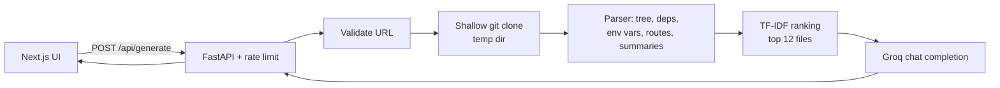

# AI Documentation Generator

Paste a public GitHub repository URL and get a draft `README.md` back. The service clones the repository, extracts facts from it (structure, dependencies, environment variables, API routes), picks the most relevant files, and asks an LLM (Groq, Llama 3.3 70B by default) to write the README from that grounded context.

The application lives in [`ai-doc-generator/`](ai-doc-generator/): a **FastAPI** backend and a **Next.js** frontend.

## Table of Contents

- [Problem and Motivation](#problem-and-motivation)
- [Key Features](#key-features)
- [Technology Stack](#technology-stack)
- [How It Works](#how-it-works)
- [Project Structure](#project-structure)
- [Prerequisites](#prerequisites)
- [Installation and Running Locally](#installation-and-running-locally)
- [Configuration](#configuration)
- [API](#api)
- [Testing](#testing)
- [Docker](#docker)
- [Deployment](#deployment)
- [Security Considerations](#security-considerations)
- [Known Limitations](#known-limitations)
- [Future Improvements](#future-improvements)
- [Contributing](#contributing)

## Problem and Motivation

Many good projects ship with no README or a stale one. Writing one by hand means re-reading the whole codebase. This tool automates the first draft by feeding the LLM verified facts from the repository, so the draft names real commands, files and variables instead of guesses.

## Key Features

- Validates and normalizes GitHub URLs (owner/repo format checked; only `github.com`).
- Shallow-clones into a temporary directory that is always deleted afterwards.
- Extracts the directory tree, dependencies from `package.json` / `requirements.txt` / `pyproject.toml`, an existing README, Dockerfile presence, `.env.example` variable names, and likely API routes. Manifests are looked up at the root and up to three folders deep, so monorepos work.
- Ranks file summaries with a local TF-IDF model and sends only the top matches to the LLM (no embedding API needed).
- Per-IP rate limiting (default 5 generations per hour), CORS allow-list, JSON structured logs, and a global error handler.
- Web UI with loading state, Markdown preview, copy and download.

## Technology Stack

| Layer | Technology |
|-------|------------|
| Backend | Python, FastAPI, Pydantic, GitPython, `openai` SDK pointed at Groq's OpenAI-compatible endpoint |
| Retrieval | Local TF-IDF cosine similarity (`services/vector_service.py`) |
| Frontend | Next.js 15, React 19, TypeScript, Tailwind CSS, react-markdown |
| Tests | pytest, pytest-asyncio, httpx |
| Deployment | Docker, Docker Compose, Render (`render.yaml`), Vercel |

## How It Works



1. `utils/validation.py` normalizes the URL to `https://github.com/<owner>/<repo>.git`.
2. `services/repository_service.py` clones with `--depth=1` and removes the checkout when done.
3. `parsers/repository_parser.py` builds the metadata and up to 80 file summaries (files over 1 MB, binary-like extensions and folders such as `node_modules` are skipped).
4. `services/vector_service.py` ranks summaries against a README-oriented query.
5. `prompts/readme_prompt.py` builds the prompt and `services/llm_service.py` calls Groq.

## Project Structure

```
.
├── README.md
└── ai-doc-generator/
    ├── backend/
    │   ├── main.py                 # FastAPI app, CORS, rate limit, error handler
    │   ├── api/routes.py           # POST /api/generate
    │   ├── services/               # documentation, repository (clone), llm, vector (TF-IDF)
    │   ├── parsers/                # repository_parser.py, file_filters.py
    │   ├── models/                 # Pydantic schemas and repository metadata
    │   ├── prompts/readme_prompt.py
    │   ├── utils/                  # config, validation, rate_limit, logging, exceptions
    │   ├── tests/                  # pytest suite
    │   ├── Dockerfile, requirements.txt, pytest.ini, .env.example
    ├── frontend/                   # Next.js app (app/page.tsx), Dockerfile, vercel.json
    ├── scripts/                    # PowerShell helpers for Windows
    ├── docker-compose.yml
    ├── render.yaml                 # Render blueprint for the backend
    └── *.md                        # Deployment and setup guides
```

## Prerequisites

- Python 3.11+ (the Docker image uses 3.12)
- Node.js 22 and npm (the frontend Dockerfile uses Node 22)
- `git` on the machine running the backend (used for cloning)
- A [Groq API key](https://console.groq.com/keys)

## Installation and Running Locally

```bash
git clone https://github.com/MageshS09/AI-ENHANCED-DOCUMENTATION.git
cd AI-ENHANCED-DOCUMENTATION/ai-doc-generator

# Backend (http://localhost:8000)
cd backend
python -m venv .venv
source .venv/bin/activate          # Windows: .venv\Scripts\activate
pip install -r requirements.txt
cp .env.example .env               # then set GROQ_API_KEY
uvicorn main:app --reload

# Frontend (http://localhost:3000) - in a second terminal
cd ../frontend
cp .env.example .env.local
npm install
npm run dev
```

Windows helper scripts are in `ai-doc-generator/scripts/`.

## Configuration

Backend (`backend/.env`, see `backend/.env.example`):

| Variable | Default | Purpose |
|----------|---------|---------|
| `GROQ_API_KEY` | *(empty)* | Required to generate; without it the API returns a configuration error |
| `GROQ_MODEL` | `llama-3.3-70b-versatile` | Model name |
| `GROQ_BASE_URL` | `https://api.groq.com/openai/v1` | OpenAI-compatible endpoint |
| `ALLOWED_ORIGINS` | `http://localhost:3000` | Comma-separated CORS origins |
| `LOG_LEVEL` | `INFO` | Log level |
| `RATE_LIMIT_REQUESTS` | `5` | Generations per client per window |
| `RATE_LIMIT_WINDOW_SECONDS` | `3600` | Window length |
| `TRUSTED_PROXY_COUNT` | `1` | Reverse proxies in front of the API appending to `X-Forwarded-For` (`1` on Render, `0` if exposed directly) |

Frontend (`frontend/.env.local`): `NEXT_PUBLIC_API_BASE_URL` — the backend URL (for example `http://localhost:8000`). The UI shows a configuration error when it is missing.

## API

### `GET /health`

Returns `{"status": "ok"}`.

### `POST /api/generate`

```bash
curl -X POST http://localhost:8000/api/generate \
  -H "Content-Type: application/json" \
  -d '{"repository_url": "https://github.com/owner/repository"}'
```

Success (`200`): `{"markdown": "# Project ...\n"}`.

| Status | Meaning |
|--------|---------|
| `400` | URL is not a supported GitHub repository URL |
| `422` | Malformed request body, or the repository could not be cloned (private, missing or wrong URL) |
| `429` | Rate limit exceeded |
| `500` | Server configuration incomplete (for example no `GROQ_API_KEY`) or an unexpected error |
| `502` | The LLM provider failed or returned an empty README |

## Testing

```bash
cd ai-doc-generator/backend
pip install -r requirements.txt
pytest
```

The tests use no network or API keys: cloning and the LLM client are replaced with fakes. They cover URL validation, parser behaviour (including malicious symlinks), rate limiting, TF-IDF retrieval, the LLM service's error handling, logging and the HTTP routes.

Frontend checks: `cd ai-doc-generator/frontend && npm run lint`. The frontend has no automated tests.

## Docker

```bash
cd ai-doc-generator
cp backend/.env.example backend/.env    # set GROQ_API_KEY
docker compose up --build               # backend :8000, frontend :3000
```

## Deployment

The repository includes `render.yaml` (backend as a Docker web service on Render) and `frontend/vercel.json` (Next.js on Vercel). Step-by-step instructions are in [`ai-doc-generator/PRODUCTION_DEPLOYMENT.md`](ai-doc-generator/PRODUCTION_DEPLOYMENT.md). After deploying, set `ALLOWED_ORIGINS` on the backend to the frontend URL and `NEXT_PUBLIC_API_BASE_URL` on the frontend to the backend URL.

## Security Considerations

- **Cloned repositories are untrusted.** The parser never follows symlinks and refuses any file that resolves outside the checkout, so a repository cannot make the server read its own files (such as `.env`) into the prompt or the generated README.
- Repository URLs are validated (host, owner and repository name patterns) before `git` is invoked, and git runs with prompts disabled.
- Files over 1 MB are skipped and at most 2,000 files are scanned per request.
- API keys are read from the environment; `.env` files are git-ignored.
- Generation is rate limited per client IP. Behind a proxy, set `TRUSTED_PROXY_COUNT` correctly or the limit can be bypassed or applied to the proxy's address.
- Excerpts of repository files are sent to the LLM provider (Groq). Only use it on repositories you are comfortable sharing with that provider; the service only accepts public GitHub repositories.

## Known Limitations

- The rate limiter is in memory and per process; use a shared store (for example Redis) when running several instances.
- Manifest lookup reads at most five files of each kind (nearest first) and ignores `node_modules`, `build`, `dist` and similar folders.
- Route detection is regex-based: it does not resolve router prefixes (a route registered with `prefix="/api"` is reported without it) and can miss unusual frameworks.
- Only 80 file summaries are built, and only the 12 best matches reach the LLM, so very large repositories are described from a sample.
- LLM output is not verified against the repository; review the generated README before publishing.
- Public GitHub repositories only.
- Some marketing copy in the UI (for example "~10s avg. generation" and "Free to use") is static text and is not measured or enforced by the code.
- No license file is present in the repository.

## Future Improvements

- Shared, persistent rate limiting.
- Verify commands and paths in generated Markdown against the parsed metadata.
- Frontend tests and CI for the frontend build.
- Streaming responses and support for private repositories with user-provided tokens.

## Contributing

1. Fork the repository and create a branch (`git checkout -b feature/my-change`).
2. Make the change and add or update tests in `ai-doc-generator/backend/tests/`.
3. Run `pytest` in `backend/` and `npm run lint` in `frontend/` (CI runs both, plus `tsc --noEmit`).
4. Open a pull request describing the change and the reason for it.
